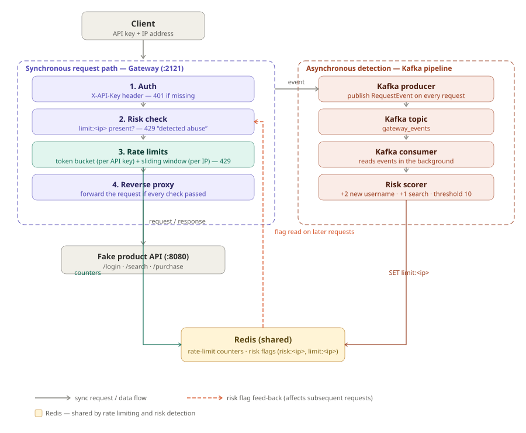

# Abuse-Aware API Gateway

A gateway that sits in front of a product API and decides whether a request is legitimate — not just by checking who's asking, but by learning how they behave over time.

Most rate limiters count requests and stop there. This one watches patterns. A login endpoint hammered with different usernames from the same IP looks nothing like a user who forgot their password. A search endpoint scraped in rapid sequence looks nothing like a curious shopper. This gateway tells the difference.

---

## What runs where

| Component | Address | Purpose |
| --- | --- | --- |
| Gateway | `http://localhost:2121` | Public entry point; rate + risk checks, then reverse-proxies to the product API |
| Fake product API | `http://localhost:8080` | Stand-in backend (`/login`, `/search`, `/purchase`) |
| Redis | `127.0.0.1:6379` | Shared counters (rate limits) and risk flags |
| Kafka | `127.0.0.1:9092` | Request-event stream for the async detection pipeline |

---

## Request flow (synchronous path)

1. Client sends a request to the gateway (`:2121`) with an `X-API-Key` header.
2. Gateway rejects a missing key with **401**.
3. **Risk check:** if `limit:<ip>` exists in Redis (set by the async detector), the request is rejected with **429 `Request blocked due to detected abuse`**.
4. **Rate limits:** the token bucket (per API key), then the sliding window (per IP), must both allow the request; otherwise **429 `Rate limit exceeded`**.
5. The request is reverse-proxied to the product API (`:8080`); the API response is returned to the client.
6. A `RequestEvent` is published to Kafka **asynchronously**; the client never waits for risk analysis.

Because detection is asynchronous, a request that *triggers* a risk flag is still allowed — the flag affects **subsequent** requests from that IP.

## Two rate-limiting strategies

Both counters live in Redis, so they work across any number of gateway instances. Both run as atomic Lua scripts.

| Strategy | Scope | Default | Catches |
| --- | --- | --- | --- |
| Token bucket | Per API key | 10 tokens, refill 1/sec | Sustained hammering with one key |
| Sliding window | Per IP | 30 requests / minute | Key rotation from the same machine |

Rotate the key and the sliding window still catches you. Slow down and the bucket refills, but the window remembers your history.

## Abuse detection (asynchronous path)

A consumer reads the event stream and computes a per-IP risk score:

| Signal | Points | Trigger |
| --- | --- | --- |
| Credential stuffing | +2 per **new** username | `POST /login` with a username not seen from that IP |
| Scraping | +1 per request | every `GET /search` |

Scores are stored under `risk:<ip>` for a 10-minute detection window. When the score reaches the threshold, the scorer writes `limit:<ip>` (with a 1-hour TTL). The synchronous path reads that flag on the next request and blocks it.

- Credential-stuffing threshold: **5 distinct usernames** (5 × 2 = 10)
- Scraping threshold: **10 searches** (10 × 1 = 10)

The sliding-window cap (30/min) is deliberately higher than both thresholds, so in the demo it is the **behavioral** layer — not the coarse rate cap — that flags abuse.

---

## Architecture



The diagram shows both paths: the synchronous request path (client → gateway checks → proxy → product API) and the asynchronous detection path (event → Kafka → consumer → risk scorer → Redis flag → subsequent decisions). Redis is shared by both the rate limiters and the risk flag.

---

## Stack

- **Go** — gateway, rate limiter, Kafka producer/consumer (`go 1.26`; see `go.mod`)
- **Redis** — shared rate-limit counters and risk flags
- **Kafka** — request-event stream
- **Docker Compose** — Kafka + Zookeeper + Redis for local development

---

## Running locally

**Prerequisites:** Go (see `go.mod`), Docker (for Kafka + Redis), and — only if you prefer not to use Docker for Redis — a local Redis server.

1. **Start Redis and Kafka** (starts `redis`, `zookeeper`, `kafka`):

   Bash / macOS / Linux:
   ```bash
   docker compose up -d
   ```

   Windows PowerShell:
   ```powershell
   docker compose up -d
   ```

2. **Start the fake product API** (port 8080):

   ```bash
   go run ./api
   ```

3. **Start the gateway** (port 2121), in a second terminal:

   ```bash
   go run .
   ```

> No Docker? Run Redis locally (`redis-server`, or on Windows use WSL/Memurai) and point Kafka at a broker you already have. The gateway expects Redis at `127.0.0.1:6379` and Kafka at `localhost:9092`.

## Demonstrating abuse detection

Requests must include an `X-API-Key` header and (for `/login`) a **valid JSON body**.

### Credential stuffing — distinct usernames

Bash:
```bash
for i in 1 2 3 4 5 6; do
  curl -s -o /dev/null -w "user$i -> %{http_code}\n" \
    -X POST http://localhost:2121/login \
    -H "X-API-Key: testkey123" -H "Content-Type: application/json" \
    -d "{\"username\":\"user$i\",\"password\":\"pw\"}"
done
```

Windows PowerShell (uses `Invoke-WebRequest`, which avoids PowerShell's native-argument quoting pitfalls):
```powershell
1..6 | ForEach-Object {
  $body = @{ username = "user$_"; password = "pw" } | ConvertTo-Json
  try {
    $r = Invoke-WebRequest -UseBasicParsing -Uri http://localhost:2121/login `
      -Method Post -Headers @{ "X-API-Key" = "testkey123" } `
      -ContentType "application/json" -Body $body
    Write-Host "user$_ -> $($r.StatusCode)"
  } catch {
    Write-Host "user$_ -> $([int]$_.Exception.Response.StatusCode) $($_.ErrorDetails.Message)"
  }
}
```

Expected: the first five logins return **200**; once the consumer has scored them the IP is flagged and later logins return **429** with body `Request blocked due to detected abuse`.

### Scraping — repeated searches

```bash
for i in $(seq 1 15); do
  curl -s -o /dev/null -w "search$i -> %{http_code}\n" \
    -X GET http://localhost:2121/search -H "X-API-Key: testkey123"
done
```

Expected: the first ~10 searches return **200**; after the score reaches 10 the IP is flagged and the rest return **429** `Request blocked due to detected abuse`.

### One-shot replay script

```bash
go run ./scripts/replay.go          # both scenarios
go run ./scripts/replay.go stuffing  # credential stuffing only
go run ./scripts/replay.go scraping  # scraping only
```

> The replay script always runs from the same IP (`127.0.0.1`) and reuses one API key. Run the two scenarios **separately** and reset state in between, otherwise the flag and counters from the first scenario will block the second:
>
> ```bash
> docker compose exec redis redis-cli FLUSHALL
> ```
> ```powershell
> docker compose exec redis redis-cli FLUSHALL
> ```

### Direct request examples

Bash:
```bash
curl -X POST http://localhost:2121/login \
  -H "X-API-Key: testkey123" -H "Content-Type: application/json" \
  -d '{"username":"alice","password":"pw"}'

curl -X GET  http://localhost:2121/search  -H "X-API-Key: testkey123"
curl -X POST http://localhost:2121/purchase -H "X-API-Key: testkey123"
```

Windows PowerShell:
```powershell
$h = @{ "X-API-Key" = "testkey123" }
Invoke-RestMethod -Uri http://localhost:2121/login -Method Post -Headers $h `
  -ContentType "application/json" -Body (@{ username = "alice"; password = "pw" } | ConvertTo-Json)
Invoke-RestMethod -Uri http://localhost:2121/search  -Method Get -Headers $h
Invoke-RestMethod -Uri http://localhost:2121/purchase -Method Post -Headers $h
```

---

## Configured thresholds

| Setting | Value | Where |
| --- | --- | --- |
| Token bucket size / refill | 10 tokens / 1 per sec, per API key | `main.go` |
| Sliding window | 30 requests / minute, per IP | `main.go` |
| Detection window | 10 minutes | `kafka/risk_scorer.go` |
| Credential-stuffing points | +2 per new username | `kafka/risk_scorer.go` |
| Scraping points | +1 per search | `kafka/risk_scorer.go` |
| Risk threshold | 10 | `kafka/risk_scorer.go` |
| Risk-flag TTL | 1 hour | `kafka/risk_scorer.go` |

## Expected responses

| Status | Body | Cause |
| --- | --- | --- |
| 200 | `{"message":"Login successful","token":"abc123xyz"}` | Login allowed (proxied) |
| 200 | `{"message":"Search results","items":["item1","item2","item3"]}` | Search allowed |
| 200 | `{"message":"Purchase successful","success":true}` | Purchase allowed |
| 401 | `Missing API key` | No `X-API-Key` header |
| 400 | `Invalid request body` | Non-JSON body on `/login` |
| 405 | `Invalid request method` | Wrong HTTP method for the route |
| 429 | `Rate limit exceeded` | Token bucket or sliding window |
| 429 | `Request blocked due to detected abuse` | `limit:<ip>` risk flag set |
| 502 | `proxy error: ...` | Product API unreachable |

---

## Tests

```bash
go test ./... -timeout 60s -count=1
go vet ./...
go build ./...
```

The abuse-detection tests are **hermetic**: they use [`miniredis`](https://github.com/alicebob/miniredis) (an in-process Redis) and fail-fast Kafka writers, so **no Redis, Kafka, or network is required** to run `go test ./...`.

---

## Known limitations

- **Kafka is required for detection.** If the broker is unavailable, events cannot be published and risk scoring silently stops happening. The handler now **logs** publish failures (`handlers: failed to publish request event: ...`) instead of swallowing them, but the gateway will not block abusive traffic until Kafka recovers.
- **Detection lag.** Scoring is asynchronous, so the request that trips the threshold is still allowed; only later requests are blocked.
- **Single-IP detection.** Distributed botnets (one request per IP) are not detected.
- **The fake API accepts any credentials.** It exists only to exercise the proxy path.
- **Docker Compose uses a single Kafka broker** and auto-created topics — fine for local demos, not production.
- **The token bucket is per API key**, shared across all IPs using that key.

---

## Design decisions

A full breakdown of the tradeoffs — why token bucket over leaky bucket, what happens when Kafka lags, how false positives are handled, and how the sliding window avoids races — is in [`docs/design.md`](./docs/design.md).
